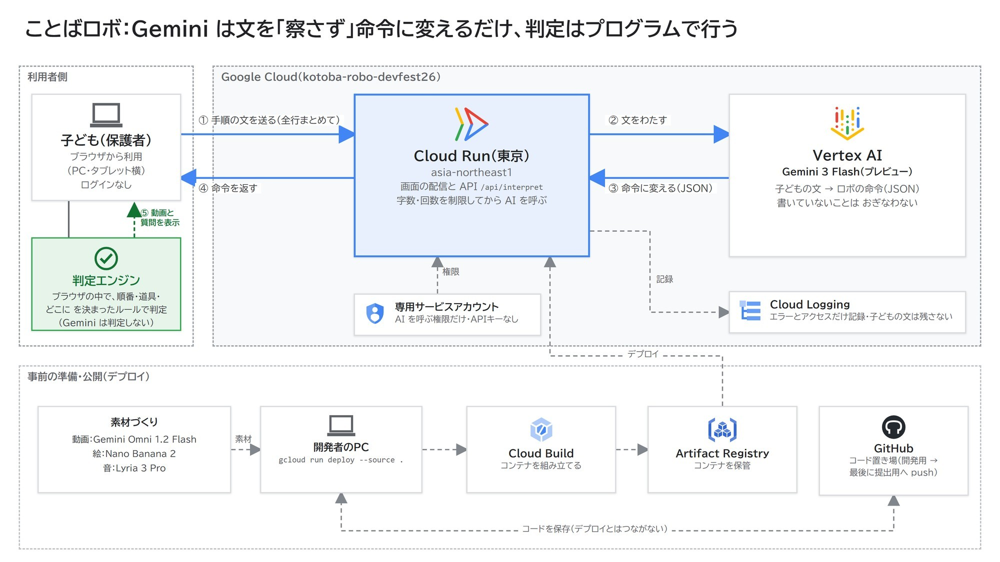

# ことばロボ

**DevFest GDGoC Japan 2026 Hackathon（東京会場）／チーム キルケ／カテゴリ: 教育**

小学生が家でひとりでも、手順を言葉で説明する練習ができる Web アプリです。くり返し使うことで、手順を筋道立てて考える**論理性**と、相手に伝わる言葉を選ぶ**表現力**を身につけることを目指しています。

子どもがおにぎりの作り方を日本語で1行ずつ書いて送ると、ロボは**書いてあることだけ**を実行します。たとえば「ごはんをにぎる」とだけ書くと、ロボは素手で茶わんのごはんをつかみ、手がごはんだらけになってしまいます。失敗したロボは「なにで にぎるの？」と聞き返しますが、答えは教えません。子どもは自分で手順を書き直し、おにぎりが完成するまで挑戦を続けます。

## 課題

いまの AI は、「この文章、いい感じにして」のようなあいまいな頼み方でも、意図をくみ取って仕上げてくれます。子どもが小さいころからこれに慣れると、順番を組み立てることも、伝わる言葉を選ぶことも、自分で考えずに済んでしまい、表現力と論理性が育ちにくくなるおそれがあります。そこで、察してくれる AI とは逆に、言葉どおりにしか動かない相手を家でいつでも使えるようにしました。

## 公開URL

**https://kotoba-robo-318647890284.asia-northeast1.run.app**

- ログインは不要です。PC かタブレットの横向きで開いてください（スマートフォンの縦向きには対応していません）
- しばらく使われていないと、最初の表示に数秒かかります（その間はロボが「起きる」動画が流れます）

## 遊び方（動作確認の手順）

1. お題「おにぎりを 作る」を選んで「はじめる」を押す
2. 次の3行を送る → 素手でにぎって失敗し「なにで にぎるの？」と聞かれる（**道具**の失敗）
   ```
   ごはんをにぎる
   うめをいれる
   のりを巻く
   ```
3. 次の5行に書き直す → にぎったあとにうめを押しこみ、ひびが入る（**順番**の失敗）
   ```
   ラップを広げる
   しゃもじでごはんをラップにのせる
   ごはんをにぎる
   うめをいれる
   のりを巻く
   ```
4. 3行目と4行目を入れかえる → うめの置き場所が分からず、テーブルに転がる（**どこに**の失敗）
5. 「うめをいれる」を「うめをごはんの真ん中にのせる」にする → 完成。最初と最後の手順が並び、変わった行に色がつく

「ごはんを丸める」のような言い換えは「にぎる」と読み取ります。「ごはんをこねる」のように知らない動作は「『こねる』って なに？」と聞き返します。

## しくみ



子どもがブラウザで書いた手順は、全行まとめて Cloud Run 上の API `/api/interpret` に送られます（①）。API は字数と回数を確かめてから、専用のサービスアカウントで Vertex AI の Gemini を呼び、文を動作・対象・道具・行き先の形に変えます（②③）。結果はブラウザに戻り（④）、ブラウザの中の判定エンジンがお題ごとの決まったルールで成功か失敗かを決めて、動画とロボの質問を出します（⑤）。

一番の工夫は、**AI に察させない**ことです。

- AI に成否まで判定させると「ふつうはラップを使うだろう」と補ってしまい、言葉どおりにしか動かないロボになりません。そこで、文を読む役と成否を決める役を分けました
- 文を読むのは Gemini です。構造化出力でスキーマを渡し、1行ごとに動作・対象・道具・行き先を決めた選択肢から返させます。書いていない道具は null、temperature は 0 です
- 成否を決めるのは、ブラウザで動く自作の**判定エンジン**（`src/lib/engine.ts`）です。お題ごとの JSON（`src/lib/onigiri.json`）に動作ごとの前提条件と結果を書いてあり、たとえば「にぎる」の前提は「ごはんがラップの上にある」です。満たさなければ失敗とし、その条件に結びつけた質問「なにで にぎるの？」を返します

子ども向けの安全対策として、1回10行・1行40字まで、1分あたり・1日あたりの送信回数に上限があります。不適切な言葉は画面に出す前に確認し、子どもの書いた文は保存しません。

## 使用した Google の技術

| 技術 | 使いどころ |
|---|---|
| Cloud Run（asia-northeast1） | 画面と API を1つのコンテナで動かす |
| Vertex AI の Gemini（gemini-3-flash-preview） | 子どもの文を構造化された手順に読み取る |
| Cloud Build・Artifact Registry | `gcloud run deploy --source .` でのビルドとイメージの保管 |
| Cloud Logging | エラーと、Cloud Run が自動で取るアクセスの記録（子どもの文は残さない） |
| Gemini Omni 1.2 Flash | キャラクターの動画8本（`public/anim/`）。Nano Banana 2 の元絵1枚から作り、見た目をそろえた |
| Nano Banana 2 | 動画の元絵・止まった絵・お題の絵 |
| Lyria 3 Pro | BGM・効果音の一部（残りは `scripts/make-sounds.py` で数式から生成） |

## 手元で動かす

Node.js 20 以上が必要です。

```bash
npm ci
npm run dev        # http://localhost:3000
```

この起動では Gemini を呼ばず、`src/lib/mock-interpret.ts`（簡単な読み取り）で動きます。
本物の Gemini で動かすときは、Vertex AI を使える Google Cloud のプロジェクトで `gcloud auth application-default login` をしてから、次のように起動します。

```bash
NEXT_PUBLIC_USE_API=1 GOOGLE_CLOUD_PROJECT=<プロジェクトID> npm run dev
```

| 環境変数 | 意味 | 既定値 |
|---|---|---|
| `NEXT_PUBLIC_USE_API` | `1` で画面から `/api/interpret`（Gemini）を呼ぶ。ビルド時に埋め込まれる | なし（モック） |
| `GOOGLE_CLOUD_PROJECT` / `GOOGLE_CLOUD_LOCATION` | Vertex AI のプロジェクトとリージョン | `kotoba-robo-devfest26` / `global` |
| `GEMINI_MODEL` | 使うモデル | `gemini-3-flash-preview` |
| `GEMINI_PER_DAY` | 1日に Gemini を呼ぶ上限 | `300` |

テストとチェック:

```bash
npm test           # vitest（判定エンジン・読み取り・API の守り）
npm run lint
```

## デプロイ

```bash
gcloud run deploy kotoba-robo --source . --region asia-northeast1
```

`Dockerfile` で Next.js の standalone 出力だけを小さいイメージに入れます。Gemini は Cloud Run の専用サービスアカウント（Vertex AI ユーザーの権限のみ）で呼ぶので、APIキーや鍵ファイルは使いません。

## フォルダ構成

```
src/
  app/              画面（トップ・おにぎりのお題）と API（/api/interpret, /api/health）
  components/       遊ぶ画面・動画・BGM
  lib/
    engine.ts       判定エンジン（成否の判定）
    onigiri.json    お題「おにぎり」の前提条件
    interpret-prompt.ts  Gemini への指示文と出力の形
    server-interpret.ts  入力の制限・回数の上限・打ち切り
    mock-interpret.ts    Gemini を使わないときの読み取り
    ng.ts           不適切な言葉の確認
public/             動画・絵・音
docs/               アーキテクチャ図
scripts/            効果音を作るスクリプト
```

## チーム

チーム キルケ

## ライセンス

[MIT License](LICENSE)
